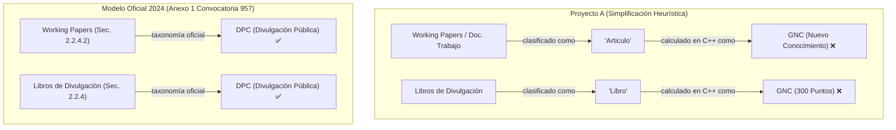

# 📊 Análisis Comparativo Técnico y Normativo — PEA-i (Taller 2)
**Universidad Popular del Cesar (UPC) — Facultad de Ingenierías y Tecnológicas**  
**Programa:** Ingeniería de Sistemas | **Asignatura:** Estructura de Datos (2026-I)  
**Docente:** Ing. Adith Bismarck Pérez Orozco  
**Propósito del documento:** Evaluación técnica, arquitectónica y normativa comparada entre las dos soluciones desarrolladas en el espacio de trabajo.

---

## 📌 1. Visión General: El Choque de Paradigmas

Ambos proyectos resuelven el **Taller 2 (Programa Estadístico de Análisis de Investigación — PEA-i)**, pero parten de dos interpretaciones arquitectónicas completamente distintas de la guía:

```
┌────────────────────────────────────────────────────────────────────────┐
│                   ENFOQUE A: "DOBLE IMPLEMENTACIÓN"                    │
│             (Proyecto: Taller2_EstructuraDatos_GrupoXX)                 │
├────────────────────────────────────────────────────────────────────────┤
│  • Solución 1 (C++ Puro): Terminal + Punteros + SQLite Amalgamado     │
│  • Solución 2 (Python Puro): Consola + Clases Nodo + Scraping          │
│  • Conexión entre ambas: NULA (solo comparten el archivo .db)          │
│  • Filosofía: Apego literal a la consigna académica tradicional.       │
└────────────────────────────────────────────────────────────────────────┘

┌────────────────────────────────────────────────────────────────────────┐
│               ENFOQUE B: "ARQUITECTURA HÍBRIDA INTEGRADA"              │
│                    (Proyecto: sys_pea_integration)                     │
├────────────────────────────────────────────────────────────────────────┤
│  • Core en C++ (RAM): Multilistas, Pila LIFO, Cola FIFO en memoria.    │
│  • Puente pybind11: C-Extension (.pyd) expuesta nativamente a Python.   │
│  • Backend FastAPI + Frontend React (SPA): Gestión y Dashboard web.    │
│  • Filosofía: Apego al Punto 14.d (Interoperabilidad entre lenguajes). │
└────────────────────────────────────────────────────────────────────────┘
```

---

## 🥊 2. Matriz Comparativa Frente a Frente (VS)

| Dimensión de Evaluación | Proyecto A (Doble Implementación) | Proyecto B (Híbrido Interoperable) | Evaluación Técnica |
| :--- | :--- | :--- | :---: |
| **Arquitectura de Software** | Dos sistemas desconectados que duplican la lógica de negocio. | Sistema monolítico distribuido en capas (C++ Core $\rightarrow$ pybind11 $\rightarrow$ FastAPI $\rightarrow$ React). | 🏆 **Proyecto B** (Estándar industria) |
| **Estructuras de Datos (TDAs)** | Punteros manuales en C++ y referencias por clases en Python. | Punteros manuales en C++ compartidos directamente con Python en RAM vía `pybind11`. | **Empate** (A en didáctica, B en rendimiento) |
| **Punto 14.d (Interoperabilidad)** | **0%:** C++ y Python no interactúan en tiempo de ejecución. | **100%:** Puente binario de alto rendimiento con `pybind11` (`abpoxx_pybind.pyd`). | 🏆 **Proyecto B (Diferencial clave)** |
| **Interfaz y Visualización (Puntos 12.b y 14.c)** | Visualizador HTML plano autogenerado por C++ + scripts Matplotlib. | SPA completa en React 18, TypeScript, TailwindCSS, shadcn/ui y TanStack Table. | 🏆 **Proyecto B (Muy superior)** |
| **Motor de Persistencia** | **SQLite3 embebido:** Autocontenido, portable, sin dependencias. | **Microsoft SQL Server + JSON:** Relacional empresarial (ODBC nativo) + fallback JSON. | 🏆 **Proyecto A en portabilidad** / **B en escalabilidad** |
| **Portabilidad / "Zero Setup"** | **Inmediata:** Doble clic en `iniciar.bat` y corre en cualquier Windows. | **Compleja:** Requiere SQL Server, ODBC 17/18, Node 20+, Python 3.12 y MSVC. | 🏆 **Proyecto A (Crítico para calificar)** |
| **Formato de Entrega (Notas 1 y 8)** | Tiene `Taller2_AB_PO_XX.cpp` y `.py` en la raíz listos. | Estructurado como repositorio de desarrollo; requiere empaquetado de entrega. | 🏆 **Proyecto A** |

---

## 🏛️ 3. Evaluación Crítica: El Modelo de Medición MinCiencias 2024

Ambos proyectos incluyen el archivo `catalogo_minciencias_2024.json` (785 líneas, 70 subtipos canónicos del Anexo 1 de la Convocatoria 957). Sin embargo, **la forma de aplicarlo marca una diferencia sustancial en la veracidad de los datos**.

### 3.1 El Error de Confundir GrupLAC con el Modelo 2024

* **GrupLAC (Plataforma SCienTI):** Es un software heredado de 2005. Sus tablas HTML presentan rótulos históricos desactualizados (*"Producción bibliográfica"*, *"Trabajos dirigidos"*, *"Demás trabajos"*).
* **Modelo MinCiencias 2024 (Convocatoria 957 / Anexo 1):** Es el marco normativo y matemático vigente que define las **5 macrofamilias**, las clases de medición (**TOP, A, B**) y los pesos ponderados de la **Tabla 6**.

> ⚠️ **Falla de planteamiento en el Proyecto A:**  
> Adoptó los 15 rótulos de pantalla de GrupLAC como si fueran el modelo oficial, reduciendo la base de datos a un `CHECK(tipo IN ('Articulo', 'Libro', ...))`, y luego intentó "adivinar" la familia con búsquedas de texto `if (t.find("..."))` en caliente.

---

### 3.2 Cruces Normativos y Falsos Positivos en el Proyecto A

Al cotejar el código del Proyecto A contra el documento oficial de MinCiencias (código `M601PR04G01`), se identifican las siguientes discrepancias:



1. **Falsos Positivos en Generación de Nuevo Conocimiento (GNC):**
   - **Documentos de trabajo (*Working Papers*):** El Anexo 1 (sección 2.2.4.2) los reubicó en **DPC**. El Proyecto A los cataloga como `"Articulo"` y los computa en **GNC**.
   - **Libros de divulgación:** El Anexo 1 (sección 2.2.4) los ubica en **DPC**. El Proyecto A los toma como `"Libro"` plano, asignándoles entre 240 y 300 puntos de **GNC**.
   - **Resultado:** Las estadísticas institucionales de GNC quedan artificialmente infladas.

2. **Colapso de la Jerarquía de Formación de Recurso Humano (FRH):**
   - MinCiencias 2024 exige separar tajantemente **FRH Tipo A** (Tesis Doctoral aprobada o con distinción) de **FRH Tipo B** (Tesis de Maestría y Pregrado). Esta distinción es requisito obligatorio para categorizar grupos en A1, A o B.
   - El Proyecto A colapsa todo en un único tipo `"Tesis"`, imposibilitando auditar el cumplimiento del escalafón ministerial.

3. **Inconsistencia Interna (JSON vs. Base de Datos vs. C++):**
   - En `data/catalogo_minciencias_2024.json` tiene los 70 subtipos correctos.
   - Pero en su SQLite (`schema.sql`) **no existen columnas** para `familia`, `subtipo_codigo`, `clase_medicion` ni `peso`.
   - En `Catalogo2024.h`, en vez de leer el catálogo, escribió valores cableados a mano con discrepancias normativas (ejemplo: al Software le asigna clase `DTI-A` y 90 puntos, cuando el Anexo 1 lo cataloga como clase **B**, peso relativo 8 y peso global 35).

---

### 3.3 El Planteamiento del Proyecto B (`sys_pea_integration`)

El Proyecto B resolvió este problema desde la raíz del diseño relacional y algorítmico:

1. **Persistencia Estructural Normalizada:**
   El modelo no es una inferencia de cadenas en memoria; reside en tablas SQL maestras:
   * `ProductFamily` (5 Macrofamilias).
   * `ProductSubtype` (70 subtipos canónicos del Anexo 1 con su `model_ref`).
   * `QualityCategory` (Clases TOP, A, B; pesos relativos y pesos globales de la Tabla 6).
2. **Ventanas Temporales Diferenciadas Oficiales:**
   No aplica un filtro uniforme de 2 o 5 años. Modela las reglas temporales de la Convocatoria 957:
   * **10 años:** Patentes de invención, variedades vegetales, obras de investigación-creación.
   * **7 años:** Artículos indexados en revistas y libros resultados de investigación.
   * **5 años:** Software, prototipos, formación y divulgación.
3. **Cálculo del Indicador de Cohesión ($I_{coh}$):**
   Audita la coautoría interna entre los miembros del grupo en productos GNC/DTI:
   $$I_{coh} = \left(\frac{\sum \text{coautores del grupo por producto}}{\text{total productos GNC/DTI evaluados}}\right) - 1.0$$
   Si $I_{coh} \le 0$, el grupo no puede clasificar en Categorías B, A ni A1 según el reglamento.
4. **Motor de Auditoría de Tiers MinCiencias:**
   Evalúa paso a paso los requisitos de existencia formal, antigüedad, integrantes, proyectos activos y pisos anualizados para determinar la categoría final:
   $$\text{Reconocido} \longrightarrow \text{Categoría C} \longrightarrow \text{Categoría B} \longrightarrow \text{Categoría A} \longrightarrow \text{Categoría A1}$$

---

## ⚖️ 4. Matriz de Riesgos Académicos ante el Docente

### ⚠️ Riesgos del Proyecto A (Doble Implementación):
1. **Objeción en la auditoría del modelo:** Si el docente revisa los pesos del C++ o nota que los *Working Papers* suman como artículos de investigación A1, cuestionará el rigor normativo del Punto 5.
2. **Mantenibilidad técnica:** El código de C++ contiene headers gigantescos con cadenas de texto HTML/JS incrustadas (`VisualizadorGrafico.h` con ~234 KB), lo cual es calificado negativamente en buenas prácticas de ingeniería.

### ⚠️ Riesgos del Proyecto B (Híbrido Interoperable):
1. **Objeción de la "Doble Solución":** El docente solicitó *"dos soluciones; una en C(C++) y otra en Python"*. Si el profesor tiene un criterio tradicional, podría decir que no hay una consola de Python con listas enlazadas nativas escritas en lenguaje Python, sino un envoltorio del `.pyd`.
2. **Falla de despliegue en la máquina del profesor:** Si el profesor intenta ejecutar el proyecto sin tener instalado Microsoft SQL Server, ODBC Driver 17/18, Node.js y Python 3.12, **el sistema no iniciará**.

---

## 🤝 5. Conclusiones y Plan de Acción Conjunto

Ambos proyectos tienen virtudes complementarias sobresalientes:
* **El Proyecto A** brilla por su **facilidad de ejecución, portabilidad inmediata y fidelidad estricta al formato de entrega de consola**.
* **El Proyecto B** brilla por su **arquitectura de ingeniería avanzada, interoperabilidad C++/Python (`pybind11`), fidelidad matemática al Modelo MinCiencias 2024 y frontend web moderno**.

### Recomendaciones para consolidar una nota máxima (5.0):
1. **Para el Proyecto A:** Actualizar la función `Catalogo2024::clasificar()` para corregir los pesos cableados y evitar que los libros de divulgación y *working papers* sumen en GNC, alineándolo con el archivo JSON que ya tiene en su carpeta.
2. **Para el Proyecto B:** Asegurar un modo de inicialización en frío basado exclusivamente en el archivo `pea_data.json` y el CLI de C++ (`pea_cli.exe`), permitiendo sustentar ante el docente sin depender de la conexión a una instancia local de SQL Server.
3. **Para la defensa oral / video:** Resaltar que el proyecto no se limitó a un CRUD escolar, sino que abordó el reto de **Interoperabilidad de Alto Rendimiento (Punto 14.d)** y el **Marco Normativo Real de MinCiencias Convocatoria 957**, posicionándolo como una solución lista para producción institucional.
